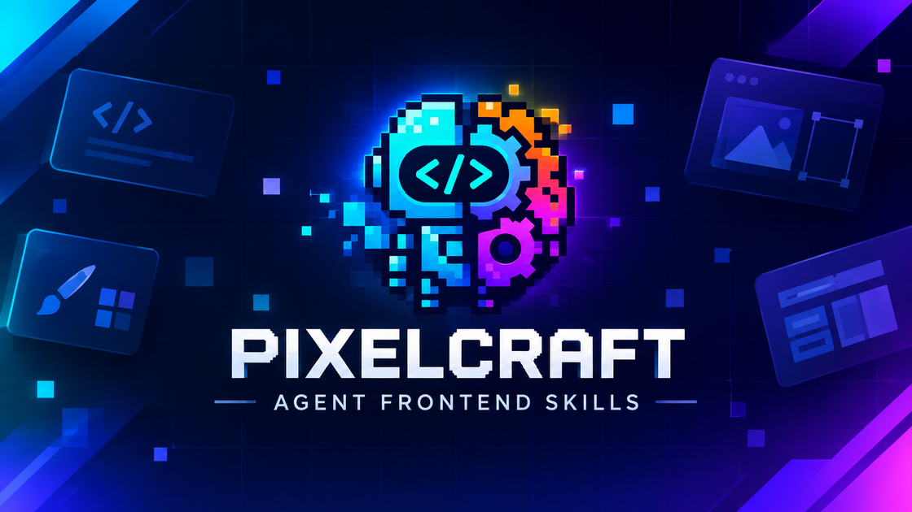
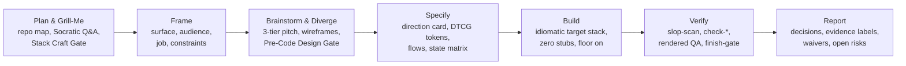

<p align="center">
  
</p>

<p align="center">
  <a href="https://github.com/ThanhNguyxnOrg/Pixelcraft/actions/workflows/validate.yml"></a>
  <a href="LICENSE"></a>
  
  
  
  = 18" />
  <a href="https://thanhnguyxnorg.github.io/Pixelcraft/"></a>
</p>

# Pixelcraft

Portable Agent Skills for distinctive, evidence-verified UI and rigorous UX across **21 programming languages** and **13 rendering surfaces**.

Pixelcraft counters generic "AI-generated" interfaces at the process level: codebase-first Socratic discovery (**Grill-Me**), 3-tier creative brainstorming with a pre-code design approval gate, a Stack Craft Gate that blocks low-craft defaults, a cross-platform accessibility/UX floor, idiomatic framework translation, and 9 zero-dependency verification CLIs with strict evidence labeling.

> **[Explore the live multi-stack showcase & 22 before/after proof exhibits →](https://thanhnguyxnorg.github.io/Pixelcraft/)**

---

## Quick Start

| Method | Command | Best for |
|---|---|---|
| **Vercel `skills` CLI** | `npx skills add ThanhNguyxnOrg/Pixelcraft` | Auto-detecting coding agents (Node `>=22.20`) |
| **npm global CLI** | `npm i -g @thanhnguyxn/pixelcraft && pixelcraft` | Interactive Node.js (`>=18`) wizard & `doctor`/`check` CLI |
| **Claude Code plugin** | `/plugin marketplace add ThanhNguyxnOrg/Pixelcraft` → `/plugin install pixelcraft@pixelcraft` | Plugin-managed updates in Claude Code |
| **Google Antigravity** | `agy plugin install https://github.com/ThanhNguyxnOrg/Pixelcraft` | Native Antigravity App & CLI plugin install |
| **curl / bash** | `curl -fsSL https://raw.githubusercontent.com/ThanhNguyxnOrg/Pixelcraft/main/install.sh \| bash -s -- --agent claude --skills all` | Linux / macOS without Node.js |
| **PowerShell** | `irm https://raw.githubusercontent.com/ThanhNguyxnOrg/Pixelcraft/main/install.ps1 \| iex` | Windows without Node.js |

For all **native host paths** (Claude Desktop/web ZIPs, ChatGPT/Codex `.codex-plugin/`, Cursor `.cursor-plugin/`, Antigravity `.antigravity-plugin/`, GitHub Copilot `.github/plugin/`, Gemini CLI, Devin CLI, Qwen Code, OpenCode, Windsurf, Kiro, Cline, Roo Code, Factory Droid, Zed, Amp, Goose, Pi), offline release archives, and maintainer release packaging, see **[`docs/INSTALL.md`](docs/INSTALL.md)**.

---

## What makes Pixelcraft different

- **Grill-Me discovery & Pre-Code Design Approval Gate:** Inspects the repository first, asks one sharp decision question per turn with `(Recommended)` choices when scope is open, and pitches 3 materially different directions—each with an ASCII wireframe and real-copy draft—before writing implementation code. Narrow fixes skip straight to direct execution.
- **Anti-Laziness Iron Laws & Stack Craft Gate:** Explicit rationalization guards ban `TODO` UI stubs, dead click handlers, invented metrics/testimonials, and lazy stack defaults (`Tkinter`, unstyled raw HTML, hand-rolled datepickers/editors/comboboxes) when production primitives exist.
- **A mandatory floor, never a uniform look:** Truthfulness, accessibility (WCAG 2.2 AA), interaction ergonomics, responsiveness, localization/RTL, performance, complete UX states, coherence, distinctiveness, and verifiability are mandatory. Heroes, cards, colors, fonts, and layout shapes are never mandated.
- **True multi-stack parity beyond React/Tailwind:** First-class skills, token exporters (19 targets), QA scripts, and offline eval fixtures across Rust, Swift, Kotlin, Python, Go, C#, C++, Dart, Java, PHP, Ruby, Elixir, R, Julia, Elm, Clojure, F#, Scala, Lua, Zig, Typst, MJML, and JS/TS.
- **Honest, evidence-labeled verification:** Every compliance claim must carry an explicit label—`rendered`, `static`, `model-judgment`, `not-checked`, or `waived`. Compiling or loading a page is never reported as visual proof.

---

## The Pixelcraft loop



**Authority order** (highest priority first): **1.** Explicit user brief → **2.** Existing project design system & conventions → **3.** Platform, legal & accessibility floor → **4.** Pixelcraft guidance → **5.** Model taste.

Full specification: [`docs/ARCHITECTURE.md`](docs/ARCHITECTURE.md) and [`docs/DESIGN-RATIONALE.md`](docs/DESIGN-RATIONALE.md).

---

## The 26 skills

Organized into **5 architectural layers**. Every folder under `skills/<name>/` is completely self-contained and independently installable.

### 1. Plan & Orchestrate (3)

| Skill | Purpose |
|---|---|
| `pixelcraft` | Orchestrator: stack/surface detection, mode classification, Iron Laws, plan-first loop, mandatory floor, evidence-labeled reporting |
| `pixelcraft-plan` | Step-zero planning: codebase-first inspection, Grill-Me single-question Socratic discovery, Stack Craft Gate, weighted stack selection, `.pixelcraft/plan.md` |
| `pixelcraft-direction` | Creative brainstorming (3-tier ambition pitch, ASCII wireframes, Pre-Code Design Approval gate), direction scoring, repetition history, anti-slop fingerprints |

### 2. Core Craft & Design System (5)

| Skill | Purpose |
|---|---|
| `pixelcraft-craft` | Typography, color systems, composition, motion language, animation principles, imagery, and icon craft |
| `pixelcraft-tokens` | DTCG 2025.10 tokens (`$root`, `$deprecated`, Resolver), Style Dictionary/Terrazzo/Figma MCP, and multi-platform export (**19 targets**) |
| `pixelcraft-ux` | JTBD, user flows, information architecture, state matrices (incl. AI/streaming/offline), forms, feedback, i18n UX, and concrete UX writing |
| `pixelcraft-accessibility` | WCAG 2.2 AA floor, native HTML APG replacements, AccessKit, reduced motion, canvas/graphics alternatives, media controls, and verification |
| `pixelcraft-brandkit` | Brand kits, identity boards, logo systems, moodboards, governance, small-size icon pipelines, and DTCG token handoff |

### 3. Domain Patterns & DataViz (2)

| Skill | Purpose |
|---|---|
| `pixelcraft-patterns` | Dashboards, commerce, SaaS billing/paywalls, RBAC/audit logs, inbox/notifications, Kanban/scheduling, diff/undo, AI-in-app, local-first sync, editors/canvas, auth, marketing, scrollytelling, search, tables/CRUD |
| `pixelcraft-dataviz` | Chart selection, truthful scales, colorblind-safe palettes, Apache ECharts, Observable Plot, Vega-Lite, Grafana/Superset, maps (MapLibre/Leaflet/Mapbox/PMTiles/Turf), streaming, node graphs, chart accessibility |

### 4. Platform & Channel Surfaces (13)

| Skill | Purpose |
|---|---|
| `pixelcraft-web` | HTML/CSS, JS/TS & non-JS web frameworks, component/interaction/search primitives (`cmdk`, Vaul, Sonner, Embla, Pagefind, Orama, Fontsource, Unpic), styling/sync/auth/editors/grids, GSAP/Motion/Lenis, Three.js WebGPU/Babylon/PlayCanvas/Threlte/TresJS, browser media players |
| `pixelcraft-mobile` | SwiftUI (iOS 26 Liquid Glass, TCA), UIKit, Jetpack Compose (M3E), Flutter, React Native/Expo, LynxJS, KMP, NativeScript/Skip, HarmonyOS ArkUI, Elixir LiveView Native, Taro/uni-app, Ionic/Capacitor, .NET MAUI, Flet, Kivy |
| `pixelcraft-desktop` | Tauri v2, Electron/Electrobun, Qt 6/PySide6/PyQt6/QML, WinUI 3/WPF, AppKit/SwiftUI macOS, GTK4/libadwaita, Avalonia 11, Rust GUI (GPUI/Slint/Dioxus/Iced/egui/libcosmic/Vizia), JavaFX/Swing, C++/Zig GUI (JUCE/GTKmm/ImGui/Nuklear/Ultralight/DVUI), Go GUI (Wails v3/Fyne/Gio), Uno |
| `pixelcraft-tui` | Textual, Rich, Ink, Bubble Tea v2/Lip Gloss v2, Ratatui, Terminal.Gui v2, Spectre.Console, prompt_toolkit, OpenTUI, FTXUI, CLI prompts, `NO_COLOR` parity, and modern terminal protocols |
| `pixelcraft-data-apps` | marimo, Solara, Mesop, Taipy, Streamlit, Gradio 5/6, Chainlit, FastHTML, Preswald, Polars/Narwhals, Reflex, NiceGUI, Dash 3, Panel, Shiny (Python/R), Jupyter/AnyWidget, Julia Genie, Observable Framework, Evidence, internal tools |
| `pixelcraft-email` | Table HTML email, MJML, React Email, Maizzle, Vue Email; Classic & New Outlook quirks, Gmail 102 KB limits, dark mode, image blocking, BIMI, plaintext parity |
| `pixelcraft-document` | Print CSS (`@page`), Typst, LaTeX, WeasyPrint, Paged.js, Playwright PDF, Gotenberg, React-PDF, `pdf-lib`, Quarto, PDF.js, PptxGenJS, Slidev/reveal.js/Marp, PDF/UA verification |
| `pixelcraft-media` | OG/social cards (Satori, Takumi, Resvg, Sharp, Playwright), SVG banners, platform safe zones, thumbnail legibility, Remotion, Motion Canvas, Revideo, FFmpeg |
| `pixelcraft-chat-ui` | Slack Block Kit, Discord Components V2, Telegram Mini Apps, Zalo, WhatsApp Flows, Teams Adaptive Cards, LINE LIFF, WeChat; Vercel AI SDK, assistant-ui, CopilotKit, AG-UI, MCP Apps, OpenAI Apps SDK, A2UI, LangGraph |
| `pixelcraft-extensions` | Chrome/Firefox/Safari MV3 (WXT, Plasmo), Shadow DOM UI, VS Code webviews/Chat/MCP, Raycast, Figma plugins/widgets, Office Add-ins, JetBrains Jewel, Obsidian, Shopify/Forge |
| `pixelcraft-constrained` | TV/10-foot (tvOS, Compose for TV, Roku, Fire TV), wearables (watchOS, Wear OS), e-ink, kiosk/POS/ISA-101 HMI, embedded (LVGL, Slint MCU, `embedded-graphics`), automotive (CarPlay, AAOS), voice (SSML & Realtime Voice AI) |
| `pixelcraft-spatial` | visionOS 2/26, Android XR, Meta Horizon OS/Spatial SDK, WebXR (`@react-three/xr` v6, Wonderland, Needle), Unity XRI, Unreal OpenXR — ergonomics, comfort, privacy, XR accessibility |
| `pixelcraft-game-ui` | Unity UI Toolkit & uGUI, Godot 4.5 (GDScript & C#), Unreal UMG/CommonUI/MVVM, LÖVE2D, Bevy, MonoGame, Ebitengine, Macroquad, Flame, Pygame/Arcade, HTML5/middleware (Phaser/PixiJS/NoesisGUI/RmlUi/Dear ImGui/Raylib/SDL3) |

### 5. Quality, Verification & Handoff (3)

| Skill | Purpose |
|---|---|
| `pixelcraft-review` | Adversarial audit/critique/polish modes, P0–P3 severity taxonomy, Nielsen + AI heuristics, persona walkthroughs, multi-language `slop-scan.mjs` |
| `pixelcraft-visual-qa` | Render/screenshot/video/trace QA, keyboard probes, contrast (`check-contrast`), email (`check-email`), terminal (`check-tui`), PDF/UA (`check-pdf`), animation & GPU evidence, `finish-gate.mjs` |
| `pixelcraft-handoff` | Approved-design translation, Figma MCP/Code Connect/Variables, Penpot, component reuse, motion handoff, missing states, visual fidelity loops |

---

## Supported stacks & 21-language routing

<details>
<summary><strong>Expand full 21-language → skill routing matrix</strong></summary>

| Language | Frameworks / surfaces | Pixelcraft skill → reference |
|---|---|---|
| **C / C++** | Qt/QML, JUCE, GTKmm, Dear ImGui, Nuklear, Ultralight, wxWidgets, FLTK, Clay, raygui, LVGL, FTXUI, Notcurses, RmlUi, NoesisGUI, SDL3, Raylib | `pixelcraft-desktop` → `cpp-gui`; `pixelcraft-tui` → `extended-tui-toolkits`; `pixelcraft-constrained` → `specialized-hardware`; `pixelcraft-game-ui` → `web-and-middleware-game-ui` |
| **C#** | Blazor, MAUI, WinUI 3/WPF, Avalonia 11, Uno, Terminal.Gui/Spectre.Console, Unity uGUI/UI Toolkit, Godot C#, MonoGame | `pixelcraft-web` → `server-rendered`; `pixelcraft-mobile` → `dotnet-maui`; `pixelcraft-desktop` → `winui-wpf`/`avalonia`/`uno-platform`; `pixelcraft-tui` → `extended-tui-toolkits`; `pixelcraft-game-ui` → `unity-ugui`/`unity-ui-toolkit`/`godot`/`monogame` |
| **Clojure** | ClojureScript, Reagent, re-frame, UIx, Helix | `pixelcraft-web` → `clojurescript` |
| **Dart** | Flutter (mobile/web/desktop), Flame game engine | `pixelcraft-mobile` → `flutter`; `pixelcraft-game-ui` → `web-and-middleware-game-ui` |
| **Elm** | Elm Browser UI | `pixelcraft-web` → `elm` |
| **Elixir** | Phoenix LiveView 1.0, LiveView Native | `pixelcraft-web` → `server-rendered`; `pixelcraft-mobile` → `harmonyos-and-emerging-mobile` |
| **F#** | Fable/Feliz/Elmish, .NET desktop UI | `pixelcraft-web` → `fsharp-fable`; desktop by target toolkit |
| **Go** | templ/templates, Bubble Tea v2/Lip Gloss v2/Huh/tview, Wails v3/Fyne/Gio, Ebitengine | `pixelcraft-web` → `server-rendered`; `pixelcraft-tui` → `bubbletea-lipgloss`/`extended-tui-toolkits`; `pixelcraft-desktop` → `go-gui`; `pixelcraft-game-ui` → `web-and-middleware-game-ui` |
| **Java** | Vaadin/Hilla/Thymeleaf/JTE/Qute, JavaFX/Swing/FlatLaf | `pixelcraft-web` → `java-web`; `pixelcraft-desktop` → `javafx-swing` |
| **Julia** | Genie/Stipple, Makie | `pixelcraft-data-apps` → `julia-genie`; `pixelcraft-dataviz` → `libraries` |
| **Kotlin** | Compose Android/TV/Wear/XR, KMP, Compose Web `wasmJs`/Kobweb, JetBrains Jewel/UI DSL | `pixelcraft-mobile` → `jetpack-compose`/`kotlin-multiplatform`; `pixelcraft-web` → `kotlin-web`; `pixelcraft-constrained` → `tv-wearables`; `pixelcraft-spatial` → `platforms`; `pixelcraft-extensions` → `ide-and-saas-plugins` |
| **Lua** | LÖVE2D, Defold | `pixelcraft-game-ui` → `love2d`/`web-and-middleware-game-ui` |
| **PHP** | Laravel Blade/Livewire/Filament, Symfony Twig/UX, Inertia v2 | `pixelcraft-web` → `server-rendered` |
| **Python** | marimo/Solara/Mesop/Taipy/Polars/Narwhals/Streamlit/Gradio/Chainlit/Reflex/NiceGUI/Dash/Panel/Shiny/Jupyter/AnyWidget/FastHTML; Django; Flet/Kivy; PySide6/PyQt6; Textual/Rich/prompt_toolkit; Pygame/Arcade; WeasyPrint/ReportLab | `pixelcraft-data-apps` matching ref; `pixelcraft-web` → `server-rendered`; `pixelcraft-mobile` → `flet`/`kivy`; `pixelcraft-desktop` → `qt-pyside-qml`; `pixelcraft-tui` → `textual`/`rich`/`extended-tui-toolkits`; `pixelcraft-game-ui` → `web-and-middleware-game-ui`; `pixelcraft-document` → `pdf-tools` |
| **R** | Shiny/bslib, ggplot2, Quarto | `pixelcraft-data-apps` → `r-shiny`; `pixelcraft-dataviz` → `libraries`; `pixelcraft-document` → `pdf-tools` |
| **Ruby** | Rails 8/Hotwire/Turbo 8/Inertia | `pixelcraft-web` → `server-rendered` |
| **Rust** | Leptos/Yew/Dioxus Web, GPUI/Slint/Dioxus/Iced/egui/Floem/Xilem/Relm4/libcosmic/Vizia, Ratatui, Bevy/Macroquad, Typst, `embedded-graphics`/Slint MCU | `pixelcraft-web` → `leptos-yew`; `pixelcraft-desktop` → `rust-gui`; `pixelcraft-tui` → `ratatui`; `pixelcraft-game-ui` → `bevy`/`web-and-middleware-game-ui`; `pixelcraft-document` → `pdf-tools`; `pixelcraft-constrained` → `specialized-hardware` |
| **Scala** | Scala.js/Laminar | `pixelcraft-web` → `scala-laminar` |
| **Swift** | SwiftUI/TCA/UIKit, AppKit/SwiftUI macOS, visionOS, Skip, tvOS/watchOS, Siri App Intents | `pixelcraft-mobile` → `swiftui`/`uikit`/`nativescript-and-skip`; `pixelcraft-desktop` → `appkit`; `pixelcraft-spatial` → `platforms`; `pixelcraft-constrained` → `tv-wearables`/`voice-ui` |
| **TS / JS / ArkTS** | React/Next/RR7/TanStack Start, Vue/Nuxt, Svelte 5, Solid, Angular, Astro 5, Qwik, Preact/Fresh/Hono, htmx/Alpine/Datastar, Lit, RN/Expo/LynxJS/NativeScript/Ionic/HarmonyOS ArkUI/Taro/uni-app, Tauri/Electron/Electrobun, Ink/OpenTUI/Clack, Observable/Evidence, React Email/Maizzle/MJML, Slidev/PDF.js/PptxGenJS, Satori/Remotion, AI SDK/assistant-ui/CopilotKit, WXT/VS Code/Raycast/Figma, Phaser/PixiJS | route by surface (`pixelcraft-web`, `pixelcraft-mobile`, `pixelcraft-desktop`, `pixelcraft-tui`, `pixelcraft-data-apps`, `pixelcraft-email`, `pixelcraft-document`, `pixelcraft-media`, `pixelcraft-chat-ui`, `pixelcraft-extensions`, `pixelcraft-game-ui`) |
| **Zig** | DVUI, C interop (`clay`/`raygui`/`SDL3`), Electrobun host | `pixelcraft-desktop` → `cpp-gui`/`electron` |

</details>

---

## Example prompts

```text
Use Pixelcraft to design a new developer billing console from scratch. Run Grill-Me discovery one question at a time, pitch 3 contrasting directions with ASCII wireframes for approval before writing code, and verify with slop-scan and contrast checks.
```

```text
Audit this checkout flow with pixelcraft-review. Separate floor violations from polish findings and label rendered evidence versus static inference.
```

```text
Build a Rust Ratatui deployment monitor with 120×36 and 80×24 NO_COLOR=1 parity using pixelcraft-tui, and verify terminal cleanliness with check-tui.mjs.
```

```text
Create a distinctive brand-kit identity board for a developer-tool startup using pixelcraft-brandkit. Compare three materially distinct brand worlds before prompting, and export the selected palette and type tokens as DTCG JSON + CSS/Swift/Rust outputs.
```

```text
Adapt this landing page for Arabic and German. Check RTL behavior, 35% string expansion, locale number/date formatting, font fallback, and idiomatic copy rather than only translating strings.
```

---

## CLI & runnable verification tools

All scripts are zero-dependency Node.js (`>=18`) `.mjs` files supporting `--help`.

### Developer CLI (`bin/pixelcraft.mjs`)

```bash
node bin/pixelcraft.mjs --help
node bin/pixelcraft.mjs list                             # list all 26 skills
node bin/pixelcraft.mjs add all --agent all --dry-run    # preview cross-agent install
node bin/pixelcraft.mjs doctor                           # audit installed skills, adapters & Node runtime
node bin/pixelcraft.mjs init-router                      # detect repo stack & print AGENTS.md router block
node bin/pixelcraft.mjs check <target>                   # run slop-scan / QA checks on a target path
node bin/pixelcraft.mjs remove <skill> --agent claude    # uninstall selected skills cleanly
```

### 9 zero-dependency QA & token scripts

| Script | Purpose & example command |
|---|---|
| `slop-scan.mjs` | Multi-language static scanner (59 UI extensions; detects `outline-removed`, TODO stubs, dead handlers, AI clichés, Compose `.dp` fonts, Flutter zoom locks, missing reduced-motion).<br/>`node skills/pixelcraft-review/scripts/slop-scan.mjs <dir> --fail-on p0 [--waivers FILE] [--json]` |
| `export-tokens.mjs` | DTCG 2025.10 exporter (`$root`, `$deprecated`, modes) across **19 targets**: `css`, `tailwind`, `swift`, `kotlin`, `dart`, `python`, `qt`, `textual`, `ts`, `scss`, `xaml`, `android-xml`, `rust`, `go-lipgloss`, `godot`, `unity-uss`, `slint`, `gtk4`, `typst` (`--format all`).<br/>`node skills/pixelcraft-tokens/scripts/export-tokens.mjs skills/pixelcraft-tokens/assets/tokens.example.json --format all --out-dir generated/tokens` |
| `check-contrast.mjs` | Exact WCAG 2.2 luminance contrast + APCA Lc (SAPC 0.0.98G-4g) directly on DTCG token JSON across modes.<br/>`node skills/pixelcraft-visual-qa/scripts/check-contrast.mjs tokens.json --mode dark [--pairs FILE] [--json]` |
| `check-email.mjs` | HTML email QA: Gmail 102 KB clip threshold, Outlook Word-engine unsafe CSS, missing `alt` / `role="presentation"`, plaintext parity.<br/>`node skills/pixelcraft-visual-qa/scripts/check-email.mjs receipt.html --plaintext receipt.txt [--json]` |
| `check-tui.mjs` | Terminal QA: inspects captured output or executes a CLI under `NO_COLOR=1` and non-TTY pipes for ANSI leaks and 80-col overflow.<br/>`node skills/pixelcraft-visual-qa/scripts/check-tui.mjs --cols 80 -- ./my-cli status` |
| `check-pdf.mjs` | Static PDF binary inspector: `%PDF-` header, size, page count, PDF/UA markers (`/StructTreeRoot`, `/MarkInfo`, `/Lang`, `/Title`), embedded fonts.<br/>`node skills/pixelcraft-visual-qa/scripts/check-pdf.mjs invoice.pdf [--json]` |
| `shoot.mjs` | Playwright browser capture across breakpoints, light/dark/reduced-motion modes, and `--keyboard` Tab focus probes.<br/>`node skills/pixelcraft-visual-qa/scripts/shoot.mjs dist/index.html --keyboard --out visual-qa` |
| `style-inventory.mjs` | Browser measurement of rendered fonts, type ratios, quantized palette clusters, motion signals, and payload.<br/>`node skills/pixelcraft-visual-qa/scripts/style-inventory.mjs dist/index.html --breakpoints 390x844,768x1024,1440x900 --out inventory.json` |
| `finish-gate.mjs` | Surface-typed evidence manifest gate (rejects reused breakpoint artifacts and lazy `n/a` excuses; exits `0` PASS, `1` FAIL/OPEN, `2` NOT CHECKED).<br/>`node skills/pixelcraft-visual-qa/scripts/finish-gate.mjs visual-qa/evidence.json` |

> **Local capture safety:** `shoot.mjs` serves only the target file's directory by default and refuses `.env`, `.git/`, and dot-segments. Pass `--root` only when parent assets are required, and `--allow-http-error` only when intentionally reviewing 404/500 designs.

### Repository validation, test suites & offline evals

```bash
npm run validate               # validate 26 skills, frontmatter, links, headings, routing sync & evals
npm run sync:docs              # auto-sync live counts & versions across README, docs, and manifests
npm test                       # run full validator, doc-sync check, distribution, installer, adapter, token, QA & slop-scan tests
npm run eval:offline           # run deterministic offline routing & fixture contract checks (70 JSON fixtures)
npm --prefix website test      # verify showcase sync, 6-exhibit gallery scores & website/src slop-scan === 0
```

---

## Repository layout

```text
bin/                         zero-dependency Node CLI (add, list, doctor, remove, init-router, check)
install.sh                   curl/bash installer (no Node required; pin with --ref <tag|sha>)
install.ps1                  PowerShell installer (no Node required; pin with -Ref <tag|sha>)
scripts/                     validator, adapter & ZIP builders, offline eval runner, and contract tests
skills/                      26 self-contained Agent Skills (247 reference docs, 9 zero-dep CLIs)
evals/                       26 behavioral eval guides + 70 machine-readable JSON fixtures
website/                     7-section React/Vite/Tailwind showcase + 22-exhibit multi-stack gallery
assets/                      brand artwork, banner, and icons
docs/ARCHITECTURE.md         system architecture and loop contract
docs/DESIGN-RATIONALE.md     contributor rationale for rules and trade-offs
docs/INSTALL.md              native host installation paths, ZIP uploads, and release notes
plugin.json                  Agent Plugins 1.0 portable manifest
gemini-extension.json        Gemini CLI extension manifest (+ GEMINI.md context bootstrap)
.claude-plugin/              Claude Code, Cowork, Droid & Qwen marketplace/plugin manifests
.cursor-plugin/              Cursor Marketplace plugin and catalog manifests
.antigravity-plugin/         Google Antigravity App & CLI plugin manifest
.codex-plugin/               OpenAI Codex / ChatGPT plugin manifest (+ .agents/plugins/)
.devin-plugin/               Devin CLI plugin manifest
.github/                     GitHub Copilot plugin marketplace, CI workflows, and templates
```

---

## Roadmap

- Live multi-model benchmark runner layered on top of the shipped 70-fixture offline harness (`npm run eval:offline`);
- Native CI visual-regression fixtures for desktop (Qt/Slint), mobile (SwiftUI/Compose), and game UI engines alongside the 22 showcase exhibits;
- Expanded DTCG Resolver alias/theme compilation and Figma Code Connect bridge examples;
- Optional localized contributor guides while preserving machine-readable English skill instructions.

---

## Contributing, security & license

- **Contributing:** Read [`CONTRIBUTING.md`](CONTRIBUTING.md), [`AGENTS.md`](AGENTS.md), and [`docs/DESIGN-RATIONALE.md`](docs/DESIGN-RATIONALE.md) before modifying rules.
- **Community & security:** Participation follows [`CODE_OF_CONDUCT.md`](CODE_OF_CONDUCT.md); report security issues via [`SECURITY.md`](SECURITY.md).
- **License:** MIT — see [`LICENSE`](LICENSE).
