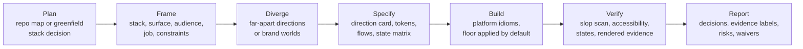

# Pixelcraft

Portable Agent Skills for distinctive, evidence-verified UI and rigorous UX across frontend stacks.

Pixelcraft is an open-source skill pack for coding agents. It helps agents move beyond interchangeable “AI-generated” interfaces by forcing design divergence before implementation, applying a cross-platform UX/accessibility floor, translating decisions idiomatically into the target stack, and reporting what was actually verified.

## Why Pixelcraft exists

LLM-generated interfaces often converge on the same visual and interaction patterns: centered heroes, generic gradients, default fonts, decorative cards, template copy, shallow states, and web-centric assumptions. Pixelcraft counters that convergence with explicit planning, authority ordering, divergence only where direction is undecided, complete UX states, accessibility and localization floors, platform-specific translation, and evidence-labeled verification.

Pixelcraft treats this as a process problem rather than a prompt slogan. It does not merely say “make it beautiful”; it changes how the agent frames, diverges, specifies, builds, verifies, and reports UI work.

## What makes it different

- **Divergence before commitment:** generate multiple materially different directions or brand worlds, score them, select one, and record why alternatives lost.
- **A mandatory floor:** accessibility, interaction, adaptation, localization, performance, state completeness, truthfulness, coherence, and evidence labeling are default constraints—not later cleanup.
- **Any frontend stack:** web, server-rendered UI, mobile, data apps, desktop, TUI, email, and game UI receive framework-specific guidance rather than copied web assumptions.
- **Honest verification:** findings are labeled `rendered`, `static`, `model-judgment`, `not-checked`, or `waived`. A successful build or page load is not presented as proof of visual quality.
- **Portable packaging:** skills follow the Agent Skills format and can be installed across multiple coding-agent hosts.

## The loop



The full architecture is documented in [`docs/ARCHITECTURE.md`](docs/ARCHITECTURE.md).

## Skills

| Skill | Purpose |
|---|---|
| `pixelcraft` | Orchestrator: stack/surface detection, mode classification, plan-first loop, mandatory floor, evidence-labeled reporting |
| `pixelcraft-plan` | Step-zero planning: brownfield repo mapping, greenfield requirements intake, weighted stack selection, `.pixelcraft/plan.md` |
| `pixelcraft-direction` | Divergent visual direction, scoring, direction cards, repetition history, anti-slop fingerprints, design movements |
| `pixelcraft-craft` | Typography, color, layout, motion, imagery, and icon craft across platforms |
| `pixelcraft-tokens` | DTCG token structure and multi-platform token export |
| `pixelcraft-ux` | JTBD, flows, information architecture, state matrices, forms, feedback, i18n UX, UX writing |
| `pixelcraft-patterns` | Dashboard/admin, commerce, editors/canvas, communication, auth/onboarding, marketing, settings, search/filtering, tables/CRUD |
| `pixelcraft-dataviz` | Chart choice, encoding, truthful labeling, colorblind-safe palettes, tables/dashboards, streaming, node graphs, maps, scalable rendering, chart accessibility |
| `pixelcraft-accessibility` | WCAG 2.2 AA floor translated into concrete platform checks and verification methods |
| `pixelcraft-review` | Audit/critique/polish modes, severity taxonomy, Nielsen checks, persona walkthroughs, slop scanning |
| `pixelcraft-visual-qa` | Render/screenshot/self-critique/fix loop, capture matrices, contrast/overflow/clipping audits, performance budgets |
| `pixelcraft-extensions` | Browser MV3 extensions, content-script Shadow DOM UI, VS Code webviews, Raycast commands, Figma/Office plugins |
| `pixelcraft-web` | HTML/CSS, React/Next, Vue/Nuxt, Svelte, Solid, Angular, Astro, Qwik, htmx/Alpine, Lit, Tailwind, server-rendered web, Rust/Kotlin/Elm/ClojureScript/F#/Scala/Java web |
| `pixelcraft-mobile` | SwiftUI, UIKit, Jetpack Compose, Flutter, React Native/Expo, Kotlin Multiplatform, Ionic/Capacitor, .NET MAUI, Flet, Kivy |
| `pixelcraft-data-apps` | Streamlit, Gradio, Reflex, NiceGUI, Dash, Panel, Shiny, Jupyter widgets, R Shiny, Julia Genie, Observable Framework, Evidence |
| `pixelcraft-desktop` | Tauri, Electron, Qt/PySide/QML, WinUI/WPF, AppKit, GTK, Avalonia, Rust GUI, JavaFX/Swing, C++ GUI, Go GUI, Uno |
| `pixelcraft-tui` | Textual, Rich, Ink, Bubble Tea/Lip Gloss, Ratatui |
| `pixelcraft-email` | Table HTML email, MJML, React Email, client quirks, dark mode, image blocking, plaintext |
| `pixelcraft-document` | Print CSS/paged media, PDF pipelines, invoices/reports/CVs, slides, projector/document legibility |
| `pixelcraft-media` | OG/social cards, SVG banners, platform safe zones, thumbnail legibility, Remotion/Motion Canvas |
| `pixelcraft-chat-ui` | Slack Block Kit, Discord components, Telegram/Mini Apps, Zalo, WhatsApp, Teams Adaptive Cards, conversation design |
| `pixelcraft-constrained` | TV/10-foot, wearables, e-ink, kiosk, embedded/LVGL, automotive templates, voice UI |
| `pixelcraft-handoff` | Approved-design translation, variables-to-token mapping, component reuse, missing states and visual fidelity loops |
| `pixelcraft-spatial` | visionOS, WebXR/Three.js/R3F/A-Frame, Quest Interaction SDK, Unity XRI, XR comfort/ergonomics/accessibility |
| `pixelcraft-game-ui` | Unity UI Toolkit, Godot, Unreal UMG, LÖVE2D, Bevy, MonoGame, HUD principles |
| `pixelcraft-brandkit` | Brand kits, identity boards, logo systems, moodboards, visual-world presentations, brand-specific prompting and QA |

## Supported stacks

| Surface | Coverage |
|---|---|
| Web | HTML/CSS, React/Next.js, Vue/Nuxt, Svelte/SvelteKit, Solid, Angular, Astro, Qwik, htmx/Alpine, Lit/Web Components, Tailwind CSS v4, Leptos/Yew, Kotlin web, Elm, ClojureScript, F#/Fable, Scala/Laminar, Vaadin/Thymeleaf |
| Server-rendered | Rails/Hotwire, Laravel Blade/Livewire, Django/Jinja, Phoenix LiveView, Blazor, Go templ/templates |
| Mobile/cross-platform apps | SwiftUI, UIKit, Jetpack Compose, Flutter, React Native/Expo, Kotlin Multiplatform, Ionic/Capacitor, .NET MAUI, Flet, Kivy |
| Data apps/internal tools | Streamlit, Gradio, Reflex, NiceGUI, Dash, Panel, Shiny for Python/R, Jupyter widgets, Julia Genie, Observable Framework, Evidence |
| Desktop | Tauri, Electron, Qt/PySide/QML, WinUI/WPF, AppKit, GTK/libadwaita, Avalonia, egui/Slint/Dioxus/iced, JavaFX/Swing, Qt C++/ImGui/wxWidgets, Fyne/Wails/Gio, Uno |
| Terminal | Textual, Rich, Ink, Bubble Tea/Lip Gloss, Ratatui |
| Email | HTML tables, MJML, React Email, Outlook/Gmail/Apple Mail constraints |
| Game UI | Unity UI Toolkit, Godot Control/Theme, Unreal UMG/Slate/CommonUI, LÖVE2D, Bevy, MonoGame, HUD/focus/safe-area principles |
| Identity | Brand-kit and visual-world generation workflows with token handoff |


### Language routing overview

| Language | Frameworks/surfaces | Pixelcraft skill → reference |
|---|---|---|
| C# | Blazor, MAUI, WinUI/WPF, Avalonia, Uno, MonoGame | `pixelcraft-web` → `server-rendered`; `pixelcraft-mobile` → `dotnet-maui`; `pixelcraft-desktop` → `winui-wpf`/`avalonia`/`uno-platform`; `pixelcraft-game-ui` → `monogame` |
| C++ | Qt/QML, Dear ImGui, wxWidgets | `pixelcraft-desktop` → `cpp-gui` |
| Clojure | ClojureScript/Reagent/re-frame | `pixelcraft-web` → `clojurescript` |
| Dart | Flutter mobile/web/desktop | `pixelcraft-mobile` → `flutter`; apply `pixelcraft-web` checks for browser-dominant surfaces |
| Elm | Elm Browser UI | `pixelcraft-web` → `elm` |
| Elixir | Phoenix LiveView | `pixelcraft-web` → `server-rendered` |
| F# | Fable/Feliz/Elmish, .NET UI | `pixelcraft-web` → `fsharp-fable`; desktop by actual framework |
| Go | templ/templates, Bubble Tea/Lip Gloss, Fyne/Wails/Gio | `pixelcraft-web` → `server-rendered`; `pixelcraft-tui` → `bubbletea-lipgloss`; `pixelcraft-desktop` → `go-gui` |
| Java | Vaadin/Thymeleaf, JavaFX/Swing | `pixelcraft-web` → `java-web`; `pixelcraft-desktop` → `javafx-swing` |
| Julia | Genie/Stipple | `pixelcraft-data-apps` → `julia-genie` |
| Kotlin | Compose, KMP, Compose Web/Kobweb | `pixelcraft-mobile` → `jetpack-compose`/`kotlin-multiplatform`; `pixelcraft-web` → `kotlin-web` |
| Lua | LÖVE2D | `pixelcraft-game-ui` → `love2d` |
| PHP | Laravel Blade/Livewire | `pixelcraft-web` → `server-rendered` |
| Python | Streamlit/Gradio/Reflex/NiceGUI/Dash/Panel/Shiny/Jupyter; Flet/Kivy; Qt/PySide; Textual/Rich | `pixelcraft-data-apps` matching reference; `pixelcraft-mobile` → `flet`/`kivy`; `pixelcraft-desktop` → `qt-pyside-qml`; `pixelcraft-tui` → `textual`/`rich` |
| R | Shiny/bslib | `pixelcraft-data-apps` → `r-shiny` |
| Ruby | Rails/Hotwire | `pixelcraft-web` → `server-rendered` |
| Rust | Leptos/Yew, egui/Slint/Dioxus/iced, Ratatui, Bevy | `pixelcraft-web` → `leptos-yew`; `pixelcraft-desktop` → `rust-gui`; `pixelcraft-tui` → `ratatui`; `pixelcraft-game-ui` → `bevy` |
| Scala | Scala.js/Laminar | `pixelcraft-web` → `scala-laminar` |
| Swift | SwiftUI, UIKit, AppKit | `pixelcraft-mobile` → `swiftui`/`uikit`; `pixelcraft-desktop` → `appkit` |
| TS/JS | React/Next, Vue/Nuxt, Svelte, Solid, Angular, Astro, Qwik, htmx/Alpine, Lit, Observable Framework, Evidence, Electron/Tauri, Ink | `pixelcraft-web` matching reference; `pixelcraft-data-apps` → `observable-framework`/`evidence`; `pixelcraft-desktop`/`pixelcraft-tui` matching reference |
| Zig | no dedicated substantive reference yet | plan manually in `pixelcraft-plan`; inspect actual UI/library constraints |

## Install

| Method | Command | Best for |
|---|---|---|
| Guided installer | `npx pixelcraft` | First-time setup; choose agents, skills, and scope interactively |
| Direct CLI | `npx pixelcraft add all --agent claude` | Reproducible Node-based setup and automation |
| Vercel `skills` CLI | `npx skills add ThanhNguyxn07/Pixelcraft` | The cross-agent skills ecosystem and agent auto-detection |
| Claude Code plugin | `/plugin marketplace add ThanhNguyxn07/Pixelcraft` then `/plugin install pixelcraft@pixelcraft` | Claude Code users who want plugin-managed updates |
| curl/bash installer | `curl -fsSL https://raw.githubusercontent.com/ThanhNguyxn07/Pixelcraft/main/install.sh \| bash -s -- --agent claude --skills all` | Linux/macOS without Node.js |
| PowerShell installer | `irm https://raw.githubusercontent.com/ThanhNguyxn07/Pixelcraft/main/install.ps1 \| iex` | Windows without Node.js |
| GitHub Release asset | Download `pixelcraft-skills.zip` or `pixelcraft-skills.tar.gz` from Releases | Controlled offline/manual distribution |
| git clone/copy | `git clone --depth 1 https://github.com/ThanhNguyxn07/Pixelcraft.git` | Pinning, inspection, and manual per-agent copying |

Details and target-specific paths follow. The matrix below records the targets implemented by Pixelcraft's bundled installers. Agent directories evolve quickly; verify target behavior in the host before depending on it in automation.

### Guided and direct Pixelcraft installer

Run with no arguments for the zero-dependency interactive wizard:

```bash
npx pixelcraft
```

The wizard asks for one or more agents, all skills or a numbered subset, and project or user-level scope. It uses Node's `readline` only; there are no package dependencies. Non-interactive flags remain available for automation:

```bash
# Everything for one agent in the current project
npx pixelcraft add all --agent claude

# A subset for multiple agents; repeat --agent instead of using commas if preferred
npx pixelcraft add pixelcraft-web pixelcraft-review --agent claude,cursor

# User-level installation
npx pixelcraft add all --agent claude --global

# Preview and controlled replacement
npx pixelcraft add all --agent all --dry-run
npx pixelcraft add all --agent claude --force
```

When a subset is requested, the installer automatically includes the required `pixelcraft` orchestrator and `pixelcraft-plan` step-zero skill and prints a note. Auto-added core skills install only when missing; `--force` applies only to explicitly requested skills. Without `--force`, existing skill directories are skipped so local edits are not silently deleted. The installer refuses symlinked target skill directories rather than following them outside the project.

Installer agent names are `claude`, `codex`, `agents`, `devin`, `cursor`, `gemini`, `copilot`, `windsurf`, `opencode`, `kiro`, and `all`, with aliases `claude-code`, `gemini-cli`, `github-copilot`, and `open-code`.

| Agent | Project path | User path | What Pixelcraft installs |
|---|---|---|---|
| Claude Code | `.claude/skills` | `~/.claude/skills` | Native skills plus `.claude/commands` adapter files |
| Codex / generic agents / Devin | `.agents/skills` | `~/.agents/skills` | Native skills only |
| Cursor | `.cursor/skills` | `~/.cursor/skills` | Native skills plus `.cursor/rules/pixelcraft.mdc` |
| Gemini CLI | `.gemini/skills` | `~/.gemini/skills` | Native skills only |
| GitHub Copilot | `.github/skills` | `~/.copilot/skills` | Native skills plus instruction/prompt adapter files |
| OpenCode | `.opencode/skills` | `~/.config/opencode/skills` | Native skills only |
| Windsurf | `.windsurf` | `~/.codeium/windsurf` | Adapter-only skill payload under `skills/` plus rules/memory and workflow routers |
| Kiro | `.kiro` | `~/.kiro` | Adapter-only skill payload under `pixelcraft/skills` plus steering router |

`--agent all` installs every target and deduplicates shared `.agents/skills` destinations.

### Vercel `skills` CLI

The external `skills` CLI supports GitHub shorthand discovery and interactive agent selection. It requires Node.js 22.20 or newer:

```bash
npx skills add ThanhNguyxn07/Pixelcraft
```

A non-interactive selection uses its documented flags, for example:

```bash
npx skills add ThanhNguyxn07/Pixelcraft --skill pixelcraft-web -a claude-code
```

Add `-g` for user-level installation. That CLI owns its own detection behavior and supports more agents than Pixelcraft's bundled installer.

### Claude Code plugin marketplace

Inside Claude Code, add the repository as a marketplace and install the plugin. Both the marketplace and plugin are named `pixelcraft` in `.claude-plugin/marketplace.json`:

```text
/plugin marketplace add ThanhNguyxn07/Pixelcraft
/plugin install pixelcraft@pixelcraft
```

The equivalent shell commands are `claude plugin marketplace add ThanhNguyxn07/Pixelcraft` and `claude plugin install pixelcraft@pixelcraft`.

### curl/bash installer without Node.js

```bash
curl -fsSL https://raw.githubusercontent.com/ThanhNguyxn07/Pixelcraft/main/install.sh | bash -s -- --agent claude --skills all
```

The script downloads the GitHub source tarball, extracts it temporarily, and copies self-contained skill folders. It supports:

```text
--agent claude,cursor   target agent(s); default agents
--skills all            comma-separated skills or all; default all
--global                user-level scope; project scope is the default
--force                 replace explicitly requested existing skills
--dry-run               print copies without writing files
--ref v0.1.0            branch, tag, or commit archive; default main
--archive path.tar.gz   use a local tarball instead of downloading
```

It never uses sudo, requires only curl or wget plus tar, refuses symlinked targets/skill folders, and skips existing folders unless `--force` is passed. Existing auto-added core skills are skipped whether `--force` is present or not. For hosts with native rule/workflow/steering surfaces, it also writes the same small router adapters as the Node installer without inlining skill bodies.

### PowerShell installer without Node.js

Default installation into the universal project `.agents/skills` directory:

```powershell
irm https://raw.githubusercontent.com/ThanhNguyxn07/Pixelcraft/main/install.ps1 | iex
```

Pass parameters by invoking the downloaded script as a script block:

```powershell
iex "& { $(irm https://raw.githubusercontent.com/ThanhNguyxn07/Pixelcraft/main/install.ps1) } -Agent claude -Skill pixelcraft-web"
```

Parameters mirror the shell script: `-Agent`, `-Skill`, `-Global`, `-Force`, `-DryRun`, `-Ref`, `-Repo`, and `-Archive` (`-Archive` expects a local `.zip`; the shell script's `--archive` expects `.tar.gz`). The script downloads the repository zip with `Invoke-WebRequest`, expands it with `Expand-Archive`, never uses sudo/elevation, refuses reparse-point targets, and preserves existing folders unless `-Force` is passed for explicitly selected skills.

### GitHub Release download

The release workflow runs when a `v*` tag is pushed. It validates the skills, builds the adapter fragments, packages `pixelcraft-skills.zip` and `pixelcraft-skills.tar.gz`, creates the GitHub Release for that tag, and attaches both archives. After a tagged release exists, download it manually from the repository's Releases page, or with GitHub CLI:

```bash
gh release download <tag> --repo ThanhNguyxn07/Pixelcraft --pattern pixelcraft-skills.zip
```

Each archive contains canonical `skills/` plus generated `adapters/`. Either copy a canonical `skills/<name>` directory into a verified target or copy the matching generated project-root fragment from `adapters/<agent>/`.

### Manual git clone/copy

Clone once, choose a target directory, and copy either all skills or selected self-contained folders:

```bash
git clone --depth 1 https://github.com/ThanhNguyxn07/Pixelcraft.git
mkdir -p .agents/skills
cp -R Pixelcraft/skills/pixelcraft-web .agents/skills/
```

Use the support matrix above for the destination matching the agent. Adapter rows require copying both the skill payload and the small router files; release archive fragments preserve that layout.

Do not construct cross-skill relative links after copying; each skill folder is self-contained.

## Example prompts

```text
Use Pixelcraft to redesign this repository's settings screen. Detect the stack first, generate divergent directions, implement the selected direction idiomatically, and report verification evidence.
```

```text
Audit this checkout flow with pixelcraft-review. Separate floor violations from polish findings and label rendered evidence versus static inference.
```

```text
Build the dashboard empty, loading, error, offline, and permission-denied states using pixelcraft-ux and the matching platform skill.
```

```text
Create a premium brand-kit identity board for a developer-tool startup. Use pixelcraft-brandkit, compare distinct brand worlds before prompting, and export the selected palette/type as DTCG tokens.
```

```text
Adapt this landing page for Arabic and German. Check RTL behavior, expansion, locale formatting, font fallback, and localized copy rather than only translating strings.
```

## Tools

Validate all skill metadata, line limits, scripts, and local links:

```bash
npm run validate
```

Scan a directory for recurring AI-slop fingerprints:

```bash
node skills/pixelcraft-review/scripts/slop-scan.mjs <directory>
node skills/pixelcraft-review/scripts/slop-scan.mjs <directory> --json
```

Export the example DTCG tokens:

```bash
node skills/pixelcraft-tokens/scripts/export-tokens.mjs skills/pixelcraft-tokens/assets/tokens.example.json --format css
node skills/pixelcraft-tokens/scripts/export-tokens.mjs skills/pixelcraft-tokens/assets/tokens.example.json --format all --out-dir generated/tokens
```

Supported export formats are `css`, `tailwind`, `swift`, `kotlin`, `dart`, `python`, `qt`, `textual`, and `all`.

Capture browser visual QA evidence when Playwright is installed:

```bash
node skills/pixelcraft-visual-qa/scripts/shoot.mjs dist/index.html --out visual-qa
```

For local files, `shoot.mjs` serves only the file's own directory by default. Use `--root` only when shared parent assets are required; it exposes every non-dotfile beneath that root to page scripts during capture (`.env`, `.git/` and other dot-segments are refused). HTTP error pages are captured with their `status` recorded; use `--allow-http-error` only when intentionally reviewing 404/500 designs.

Inspect installer behavior:

```bash
node bin/pixelcraft.mjs --help
node bin/pixelcraft.mjs add all --agent all --dry-run
```

## Repository layout

```text
bin/                         zero-dependency Node installer and wizard
install.sh                  curl/bash installer (no Node required)
install.ps1                 PowerShell installer (no Node required)
scripts/                     validation tooling
skills/                      self-contained Agent Skills
docs/ARCHITECTURE.md         system design and conventions
docs/DESIGN-RATIONALE.md      contributor rationale for major rules
.claude-plugin/              Claude marketplace metadata
.github/workflows/           validation and tag-release workflows
```

## Roadmap

- evaluation corpus for visual distinctiveness, UX completeness, accessibility, localization, and cross-platform fidelity;
- showcase site with verified examples across supported stacks;
- deeper framework coverage and version-specific verification matrices;
- richer design-token conversion and implementation handoff;
- calibrated review fixtures with known good/bad examples;
- internationalization of contributor documentation where useful, while keeping skill content consistently machine-readable.

## Contributing

See [`CONTRIBUTING.md`](CONTRIBUTING.md) and [`AGENTS.md`](AGENTS.md). Before changing a rule, read the rationale in [`docs/DESIGN-RATIONALE.md`](docs/DESIGN-RATIONALE.md). Contributions must preserve the Agent Skills format, zero-dependency tooling, self-contained skill folders, evidence-label discipline, and the distinction between verified facts and model judgment.

## License

MIT — see [`LICENSE`](LICENSE).
