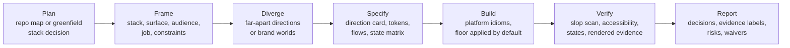

# Pixelcraft

Portable Agent Skills for distinctive, evidence-verified UI and rigorous UX across frontend stacks.

Pixelcraft is an open-source skill pack for coding agents. It helps agents move beyond interchangeable “AI-generated” interfaces by forcing design divergence before implementation, applying a cross-platform UX/accessibility floor, translating decisions idiomatically into the target stack, and reporting what was actually verified.

## Why Pixelcraft exists

LLM-generated interfaces often converge on the same visual and interaction patterns: centered heroes, generic gradients, default fonts, decorative cards, template copy, shallow states, and web-centric assumptions. Pixelcraft counters that convergence with explicit planning, authority ordering, divergence only where direction is undecided, complete UX states, accessibility and localization floors, platform-specific translation, and evidence-labeled verification.

Pixelcraft treats this as a process problem rather than a prompt slogan. It does not merely say “make it beautiful”; it changes how the agent frames, diverges, specifies, builds, verifies, and reports UI work.

## What makes it different

- **Divergence before commitment:** generate multiple materially different directions or brand worlds, score them, select one, and record why alternatives lost.
- **A mandatory floor:** accessibility, interaction, adaptation, localization, performance, state completeness, truthfulness, coherence, and evidence labeling are default constraints—not later cleanup.
- **Any frontend stack:** web, server-rendered UI, mobile, data apps, desktop, TUI, email, and game UI receive framework-specific guidance rather than copied web assumptions.
- **Honest verification:** findings are labeled `rendered`, `static`, `model-judgment`, `not-checked`, or `waived`. A successful build or page load is not presented as proof of visual quality.
- **Portable packaging:** skills follow the Agent Skills format and can be installed across multiple coding-agent hosts.

## The loop



The full architecture is documented in [`docs/ARCHITECTURE.md`](docs/ARCHITECTURE.md).

## Skills

| Skill | Purpose |
|---|---|
| `pixelcraft` | Orchestrator: stack/surface detection, mode classification, plan-first loop, mandatory floor, evidence-labeled reporting |
| `pixelcraft-plan` | Step-zero planning: brownfield repo mapping, greenfield requirements intake, optional product/stack discovery interview for unresolved material decisions, weighted stack selection, `.pixelcraft/plan.md` |
| `pixelcraft-direction` | Divergent visual direction, scoring, motion identity, evidence-based reference analysis, repetition history, anti-slop fingerprints |
| `pixelcraft-craft` | Typography, color, composition, motion language, animation principles, imagery, and icon craft |
| `pixelcraft-tokens` | DTCG 2025.10 tokens & Resolver, Style Dictionary/Terrazzo/Figma MCP, and multi-platform token export (13 targets) |
| `pixelcraft-ux` | JTBD, flows, information architecture, state matrices (incl. AI/streaming), forms, feedback, i18n UX, UX writing |
| `pixelcraft-patterns` | Dashboard/admin, commerce, SaaS billing/paywalls, multi-tenant/RBAC/audit logs, notifications/inbox, scheduling/Kanban, history/diff/undo, AI-in-app & offline sync, editors/canvas, communication, auth/onboarding, marketing, scrollytelling, settings, search/filtering, tables/CRUD |
| `pixelcraft-dataviz` | Chart choice, encoding, truthful labeling, colorblind-safe palettes, tables/dashboards, streaming, node graphs, maps/PMTiles/Turf, scalable rendering, chart accessibility |
| `pixelcraft-accessibility` | WCAG 2.2 AA floor, native HTML APG replacements, AccessKit, reduced motion, canvas/graphics alternatives, media controls, and platform verification |
| `pixelcraft-review` | Audit/critique/polish modes, severity taxonomy, Nielsen + AI heuristics, persona walkthroughs, slop scanning |
| `pixelcraft-visual-qa` | Render/screenshot/video/trace QA, animation milestone capture, document/PDF/terminal/email/mobile/desktop/game captures, and GPU performance evidence |
| `pixelcraft-extensions` | Browser MV3 extensions (WXT/Plasmo/Safari), Shadow DOM UI, VS Code webviews/Chat/MCP, Raycast, Figma plugins/widgets, Office, JetBrains, Obsidian, Shopify/Forge |
| `pixelcraft-web` | HTML/CSS, JS/TS & non-JS web frameworks, styling/component/sync/auth/editor/grid ecosystems; GSAP/Motion/Lenis, Three.js/R3F/Babylon/PlayCanvas/Threlte/TresJS/`<model-viewer>`, PixiJS/Canvas/WebGL/WebGPU/TSL, and browser audio/video players |
| `pixelcraft-mobile` | SwiftUI, UIKit, Jetpack Compose, Flutter, React Native/Expo, LynxJS, Kotlin Multiplatform, NativeScript/Skip, Ionic/Capacitor, .NET MAUI, Flet, Kivy |
| `pixelcraft-data-apps` | Streamlit, Gradio, marimo/Solara/Mesop/Taipy, Chainlit/FastHTML/Preswald/internal tools, Reflex, NiceGUI, Dash, Panel, Shiny, Jupyter/AnyWidget, R Shiny, Julia Genie, Observable Framework, Evidence |
| `pixelcraft-desktop` | Tauri v2, Electron/Electrobun, Qt 6/PySide6/QML, WinUI 3/WPF, AppKit/SwiftUI macOS, GTK4/libadwaita, Avalonia, Rust GUI (GPUI/Slint/Dioxus/Iced/egui), JavaFX/Swing, C++/Zig GUI, Go GUI (Wails v3/Fyne/Gio), Uno |
| `pixelcraft-tui` | Textual, Rich, Ink, Bubble Tea v2/Lip Gloss v2, Ratatui, Terminal.Gui v2, Spectre.Console, prompt_toolkit, OpenTUI, FTXUI, CLI prompts, and modern terminal protocols |
| `pixelcraft-email` | Table HTML email, MJML, React Email, Maizzle, Vue Email, Classic & New Outlook quirks, Gmail 102 KB limits, dark mode, image blocking, BIMI, plaintext |
| `pixelcraft-document` | Print CSS/paged media, Typst/LaTeX/WeasyPrint/Paged.js/Playwright PDF/Gotenberg/React-PDF/`pdf-lib`/Quarto, PDF.js/PptxGenJS, invoices/reports/CVs, slides, PDF/UA verification |
| `pixelcraft-media` | OG/social cards (Satori/Takumi/Resvg/Sharp/Playwright), SVG banners, platform safe zones, thumbnail legibility, Remotion/Motion Canvas/Revideo/FFmpeg |
| `pixelcraft-chat-ui` | Host-constrained messaging & mini apps (Slack Block Kit, Discord Components V2, Telegram, Zalo, WhatsApp Flows, Teams Adaptive Cards, LINE LIFF, WeChat) and app-owned AI/agentic workspaces (Vercel AI SDK, assistant-ui, CopilotKit, AG-UI, MCP Apps, OpenAI Apps SDK, A2UI, LangGraph) |
| `pixelcraft-constrained` | TV/10-foot (tvOS/Compose for TV/Roku/Fire TV), wearables (watchOS/Wear OS), e-ink, kiosk/POS/ISA-101 HMI, embedded (LVGL/Slint MCU/`embedded-graphics`), automotive (CarPlay/AAOS), voice (SSML & Realtime Voice AI) |
| `pixelcraft-handoff` | Approved-design translation, Figma MCP/Code Connect/Variables, Penpot, component reuse, motion handoff, missing states and visual fidelity loops |
| `pixelcraft-spatial` | visionOS 2/26, Android XR, Meta Horizon OS/Spatial SDK, WebXR (`@react-three/xr` v6/Wonderland/Needle), Unity XRI, Unreal OpenXR — embodied input, XR comfort/ergonomics/privacy/accessibility |
| `pixelcraft-game-ui` | Unity UI Toolkit & uGUI, Godot 4.5, Unreal UMG/CommonUI/MVVM, LÖVE2D, Bevy, MonoGame, HTML5/middleware game UI (Phaser/PixiJS/NoesisGUI/RmlUi/Dear ImGui/Raylib/SDL3), HUD principles |
| `pixelcraft-brandkit` | Brand kits, identity boards, logo systems, moodboards, governance, small-size icon pipelines, and token handoff |

## Supported stacks

| Surface | Coverage |
|---|---|
| Web | HTML/CSS, React/Next/React Router v7/TanStack Start, Vue/Nuxt/Pinia, Svelte 5/SvelteKit 2, Solid/SolidStart, Angular, Astro 5, Qwik, Preact/Fresh/Hono, htmx/Alpine/Datastar/Unpoly, Lit/Web Components, Tailwind CSS v4, Rust Leptos/Yew/Dioxus, Kotlin/Wasm/Kobweb, Elm, ClojureScript, F#/Fable, Scala/Laminar, Java Vaadin/Hilla/Thymeleaf; sync engines (Zero/ElectricSQL/Yjs/PowerSync/Convex), auth/checkout, editors, grids, Three.js/WebGPU/Babylon/PlayCanvas/Threlte/TresJS, browser media players |
| Server-rendered | Rails 8/Hotwire, Laravel Blade/Livewire, Inertia.js v2, Django/Jinja, FastHTML, Phoenix LiveView 1.0, Blazor .NET 9/10, Go templ/templates |
| Mobile/cross-platform apps | SwiftUI (iOS 26 Liquid Glass), UIKit, Jetpack Compose (Material 3 Expressive), Flutter (Impeller/Skwasm), React Native/Expo (New Architecture/Expo Router/Uniwind), LynxJS, Kotlin Multiplatform (Compose iOS), NativeScript, Skip, Ionic/Capacitor, .NET MAUI, Flet, Kivy/KivyMD |
| Data apps/internal tools | marimo, Solara, Mesop, Taipy, Streamlit, Gradio 5/6, Chainlit, FastHTML, Preswald, Reflex, NiceGUI, Dash 3, Panel, Shiny for Python/R, Jupyter/AnyWidget/Voilá, Julia Genie/Stipple, Observable Framework, Evidence, Retool/Appsmith/ToolJet |
| Desktop | Tauri v2, Electron, Electrobun, Qt 6/PySide6/QML, WinUI 3/WPF, AppKit/SwiftUI macOS, GTK4/libadwaita, Avalonia 11, Rust GPUI/Slint/Dioxus/Iced/egui/Floem/Xilem/Relm4, JavaFX/Swing/FlatLaf, C++ Qt/ImGui/wxWidgets/FLTK/Zig DVUI, Go Fyne/Wails v3/Gio, Uno |
| Terminal | Textual, Rich, Ink, Bubble Tea v2/Lip Gloss v2/Huh, Ratatui, Terminal.Gui v2, Spectre.Console, prompt_toolkit, OpenTUI, FTXUI, Notcurses, Clack/Inquirer, modern terminal protocols (DEC 2026/Kitty/Sixel/OSC 8) |
| Email | HTML tables, MJML, React Email, Maizzle, Vue Email; Classic & New Outlook, Gmail 102 KB limits, Apple Mail dark mode, BIMI, plaintext parity |
| Document & slides | Print CSS (`@page`/margin boxes), Typst, LaTeX, WeasyPrint, Paged.js, Playwright PDF, Gotenberg, PrinceXML, Vivliostyle, React-PDF, `pdf-lib`, Quarto, PDF.js, PptxGenJS, Slidev, reveal.js, Marp |
| External media | OG/social cards (Satori, Takumi, Resvg, Sharp, Playwright), SVG posters, Remotion v4, Motion Canvas, Revideo, FFmpeg, YouTube/Bluesky/Discord/WhatsApp safe zones |
| Chat & AI-native UI | Slack Block Kit/AI Assistant, Discord Components V2/Activities, Telegram Mini Apps, Zalo, WhatsApp Flows, Teams Adaptive Cards, LINE LIFF, WeChat; Vercel AI SDK, assistant-ui, CopilotKit, AG-UI, MCP Apps, OpenAI Apps SDK, A2UI, LangGraph |
| Extensions & plugins | Chrome/Firefox/Safari MV3 (WXT, Plasmo, CRXJS), VS Code webviews/Chat/MCP, Raycast, Figma plugins/widgets, Office Add-ins, JetBrains Jewel/UI DSL, Obsidian, Shopify App Bridge/Polaris, Atlassian Forge |
| Constrained & voice | tvOS, Compose for TV, Roku BrightScript, Fire TV/Vega OS, watchOS, Wear OS, e-ink, kiosk/POS/ISA-101 HMI, LVGL/Slint MCU/`embedded-graphics`, CarPlay/AAOS, SSML & Realtime Voice AI |
| Spatial & XR | visionOS 2/26, Android XR (Compose for XR), Meta Horizon OS/Spatial SDK, WebXR (`@react-three/xr` v6/Wonderland/Needle), Unity XRI, Unreal OpenXR |
| Game UI | Unity UI Toolkit & uGUI, Godot 4.5, Unreal UMG/CommonUI/MVVM, LÖVE2D, Bevy, MonoGame, Phaser/PixiJS/Kaplay, NoesisGUI/RmlUi/Gameface/Dear ImGui HUD, Raylib/SDL3/Defold/Cocos |
| Identity | Brand-kit, logo systems, small-size icon pipelines, and visual-world generation workflows with DTCG token handoff |

### Language routing overview

| Language | Frameworks/surfaces | Pixelcraft skill → reference |
|---|---|---|
| C / C++ | Qt/QML, Dear ImGui, wxWidgets, FLTK, Clay, raygui, LVGL, FTXUI, Notcurses, RmlUi, NoesisGUI, SDL3, Raylib | `pixelcraft-desktop` → `cpp-gui`; `pixelcraft-tui` → `extended-tui-toolkits`; `pixelcraft-constrained` → `specialized-hardware`; `pixelcraft-game-ui` → `web-and-middleware-game-ui` |
| C# | Blazor, MAUI, WinUI/WPF, Avalonia, Uno, Terminal.Gui/Spectre.Console, Unity uGUI/UI Toolkit, MonoGame | `pixelcraft-web` → `server-rendered`; `pixelcraft-mobile` → `dotnet-maui`; `pixelcraft-desktop` → `winui-wpf`/`avalonia`/`uno-platform`; `pixelcraft-tui` → `extended-tui-toolkits`; `pixelcraft-game-ui` → `unity-ugui`/`unity-ui-toolkit`/`monogame` |
| Clojure | ClojureScript/Reagent/re-frame/UIx/Helix | `pixelcraft-web` → `clojurescript` |
| Dart | Flutter mobile/web/desktop | `pixelcraft-mobile` → `flutter`; pair `pixelcraft-desktop` or `pixelcraft-web` checks by primary surface |
| Elm | Elm Browser UI | `pixelcraft-web` → `elm` |
| Elixir | Phoenix LiveView | `pixelcraft-web` → `server-rendered` |
| F# | Fable/Feliz/Elmish, .NET UI | `pixelcraft-web` → `fsharp-fable`; desktop by actual framework |
| Go | templ/templates, Bubble Tea/Lip Gloss/Huh/tview, Fyne/Wails (v2/v3)/Gio | `pixelcraft-web` → `server-rendered`; `pixelcraft-tui` → `bubbletea-lipgloss`/`extended-tui-toolkits`; `pixelcraft-desktop` → `go-gui` |
| Java | Vaadin/Hilla/Thymeleaf/JTE/Qute, JavaFX/Swing/FlatLaf | `pixelcraft-web` → `java-web`; `pixelcraft-desktop` → `javafx-swing` |
| Julia | Genie/Stipple, Makie | `pixelcraft-data-apps` → `julia-genie`; `pixelcraft-dataviz` → `libraries` |
| Kotlin | Compose Android/TV/Wear/XR, KMP, Compose Web `wasmJs`/Kobweb, JetBrains Jewel/UI DSL | `pixelcraft-mobile` → `jetpack-compose`/`kotlin-multiplatform`; `pixelcraft-web` → `kotlin-web`; `pixelcraft-constrained` → `tv-wearables`; `pixelcraft-spatial` → `platforms`; `pixelcraft-extensions` → `ide-and-saas-plugins` |
| Lua | LÖVE2D, Defold | `pixelcraft-game-ui` → `love2d`/`web-and-middleware-game-ui` |
| PHP | Laravel Blade/Livewire/Inertia | `pixelcraft-web` → `server-rendered` |
| Python | marimo/Solara/Mesop/Taipy/Streamlit/Gradio/Chainlit/Reflex/NiceGUI/Dash/Panel/Shiny/Jupyter/AnyWidget/FastHTML; Django; Flet/Kivy/KivyMD; Qt/PySide6; Textual/Rich/prompt_toolkit; WeasyPrint/ReportLab | `pixelcraft-data-apps` matching ref; `pixelcraft-web` → `server-rendered`; `pixelcraft-mobile` → `flet`/`kivy`; `pixelcraft-desktop` → `qt-pyside-qml`; `pixelcraft-tui` → `textual`/`rich`/`extended-tui-toolkits`; `pixelcraft-document` → `pdf-tools` |
| R | Shiny/bslib, ggplot2, Quarto | `pixelcraft-data-apps` → `r-shiny`; `pixelcraft-dataviz` → `libraries`; `pixelcraft-document` → `pdf-tools` |
| Ruby | Rails/Hotwire/Turbo 8/Inertia | `pixelcraft-web` → `server-rendered` |
| Rust | Leptos/Yew/Dioxus Web, GPUI/Slint/Dioxus/Iced/egui/Floem/Xilem/Relm4, Ratatui, Bevy, Typst, `embedded-graphics`/Slint MCU | `pixelcraft-web` → `leptos-yew`; `pixelcraft-desktop` → `rust-gui`; `pixelcraft-tui` → `ratatui`; `pixelcraft-game-ui` → `bevy`; `pixelcraft-document` → `pdf-tools`; `pixelcraft-constrained` → `specialized-hardware` |
| Scala | Scala.js/Laminar | `pixelcraft-web` → `scala-laminar` |
| Swift | SwiftUI/UIKit, AppKit/SwiftUI macOS, visionOS, Skip, tvOS/watchOS, Siri App Intents | `pixelcraft-mobile` → `swiftui`/`uikit`/`nativescript-and-skip`; `pixelcraft-desktop` → `appkit`; `pixelcraft-spatial` → `platforms`; `pixelcraft-constrained` → `tv-wearables`/`voice-ui` |
| TS/JS | React/Next/RR7/TanStack Start, Vue/Nuxt, Svelte, Solid, Angular, Astro, Qwik, Preact/Fresh/Hono, htmx/Alpine/Datastar, Lit, RN/Expo/LynxJS/NativeScript/Ionic, Tauri/Electron/Electrobun, Ink/OpenTUI/Clack, Observable/Evidence, React Email/Maizzle/MJML, Slidev/PDF.js/PptxGenJS, Satori/Remotion, AI SDK/assistant-ui/CopilotKit, WXT/VS Code/Raycast/Figma, Phaser/PixiJS | route by surface (`pixelcraft-web`, `pixelcraft-mobile`, `pixelcraft-desktop`, `pixelcraft-tui`, `pixelcraft-data-apps`, `pixelcraft-email`, `pixelcraft-document`, `pixelcraft-media`, `pixelcraft-chat-ui`, `pixelcraft-extensions`, `pixelcraft-game-ui`) |
| Zig | DVUI, C interop (`clay`/`raygui`/`SDL3`), Electrobun host | `pixelcraft-desktop` → `cpp-gui`/`electron`; verify current library APIs in `pixelcraft-plan` |

## Install

| Method | Command | Best for |
|---|---|---|
| Guided installer | `node <checkout>/bin/pixelcraft.mjs` | First-time setup; choose agents, skills, and scope interactively |
| Direct CLI | `node <checkout>/bin/pixelcraft.mjs add all --agent claude` | Reproducible Node-based setup and automation |
| Vercel `skills` CLI | `npx skills add ThanhNguyxnOrg/Pixelcraft` | The cross-agent skills ecosystem and agent auto-detection |
| Claude Code plugin | `/plugin marketplace add ThanhNguyxnOrg/Pixelcraft` then `/plugin install pixelcraft@pixelcraft` | Claude Code users who want plugin-managed updates |
| curl/bash installer | `curl -fsSL https://raw.githubusercontent.com/ThanhNguyxnOrg/Pixelcraft/main/install.sh \| bash -s -- --agent claude --skills all` | Linux/macOS without Node.js |
| PowerShell installer | `irm https://raw.githubusercontent.com/ThanhNguyxnOrg/Pixelcraft/main/install.ps1 \| iex` | Windows without Node.js |
| GitHub Release asset | Download `pixelcraft-skills.zip` or `pixelcraft-skills.tar.gz` from Releases | Controlled offline/manual distribution |
| git clone/copy | `git clone --depth 1 https://github.com/ThanhNguyxnOrg/Pixelcraft.git` | Pinning, inspection, and manual per-agent copying |

Details and target-specific paths follow. The matrix below records the targets implemented by Pixelcraft's bundled installers. Agent directories evolve quickly; verify target behavior in the host before depending on it in automation.

### Guided and direct Pixelcraft installer

Clone the repository once, then run the bundled installer from the project that should receive the skills. Replace the example checkout path if you use a different location:

```bash
git clone https://github.com/ThanhNguyxnOrg/Pixelcraft.git "$HOME/Pixelcraft"
node "$HOME/Pixelcraft/bin/pixelcraft.mjs"
```

The wizard asks for one or more agents, all skills or a numbered subset, project or user-level scope, and whether to show optional Context7 setup guidance. It uses Node's `readline` only; there are no package dependencies. Prefer a supported Node.js LTS release; `>=18` is a compatibility floor, not a recommendation to run an end-of-life runtime. Non-interactive flags remain available for automation:

```bash
# Everything for one agent in the current project
node "$HOME/Pixelcraft/bin/pixelcraft.mjs" add all --agent claude

# A subset for multiple agents; repeat --agent instead of using commas if preferred
node "$HOME/Pixelcraft/bin/pixelcraft.mjs" add pixelcraft-web pixelcraft-review --agent claude,cursor

# User-level installation
node "$HOME/Pixelcraft/bin/pixelcraft.mjs" add all --agent claude --global

# Preview and controlled replacement
node "$HOME/Pixelcraft/bin/pixelcraft.mjs" add all --agent all --dry-run
node "$HOME/Pixelcraft/bin/pixelcraft.mjs" add all --agent claude --force
```

When a subset is requested, the installer automatically includes the required `pixelcraft` orchestrator and `pixelcraft-plan` step-zero skill and prints a note. Auto-added core skills install only when missing; `--force` applies only to explicitly requested skills. Without `--force`, existing skill directories are skipped so local edits are not silently deleted. The installer refuses symlinked target skill directories rather than following them outside the project.

Installer agent names are `claude`, `codex`, `agents`, `devin`, `cursor`, `gemini`, `copilot`, `windsurf`, `opencode`, `kiro`, `cline`, `roo`, `droid`, `antigravity`, and `all`. Amp, Zed, and Goose can use `--agent amp`, `--agent zed`, and `--agent goose`, which select the shared `agents` directory. Other aliases: `claude-code`, `gemini-cli`, `github-copilot`, `open-code`, `roo-code`, and `factory`.

| Agent | Project path | User path | What Pixelcraft installs |
|---|---|---|---|
| Claude Code | `.claude/skills` | `~/.claude/skills` | Native skills plus `.claude/commands` adapter files |
| Codex / generic agents / Devin | `.agents/skills` | `~/.agents/skills` | Native skills only |
| Cursor | `.cursor/skills` | `~/.cursor/skills` | Native skills plus `.cursor/rules/pixelcraft.mdc` |
| Gemini CLI | `.gemini/skills` | `~/.gemini/skills` | Native skills only |
| GitHub Copilot | `.github/skills` | `~/.copilot/skills` | Native skills plus instruction/prompt adapter files |
| OpenCode | `.opencode/skills` | `~/.config/opencode/skills` | Native skills only |
| Windsurf | `.windsurf` | `~/.codeium/windsurf` | Native skills under `skills/` plus rules/memory and workflow routers |
| Kiro | `.kiro/skills` | `~/.kiro/skills` | Native skills plus the steering adapter |
| Cline | `.cline/skills` | `~/.cline/skills` | Native skills |
| Roo Code | `.roo/skills` | `~/.roo/skills` | Native skills |
| Factory Droid | `.factory/skills` | `~/.factory/skills` | Native skills |
| Google Antigravity | `.agents/skills` | `~/.gemini/config/skills` | Native skills; project path works with the app and CLI |

`--agent all` installs every target and deduplicates shared `.agents/skills` destinations.

For version-sensitive work, Pixelcraft asks the agent to check the resolved version against official docs and the relevant registry. [Context7](https://github.com/upstash/context7#readme) can help retrieve docs when a host supports it. Use `--docs-mcp` (Node or Bash) or `-DocsMcp` (PowerShell) to print setup guidance, including with dry-run. This does not install tools, edit MCP config, or request keys. Reuse an approved existing MCP connection; otherwise use official docs and registry lookup. Never send secrets or proprietary code in lookup queries.

### Vercel `skills` CLI

The external `skills` CLI supports GitHub shorthand discovery and interactive agent selection. It requires Node.js 22.20 or newer:

```bash
npx skills add ThanhNguyxnOrg/Pixelcraft
```

A non-interactive selection uses its documented flags, for example:

```bash
npx skills add ThanhNguyxnOrg/Pixelcraft --skill pixelcraft --skill pixelcraft-plan --skill pixelcraft-web -a claude-code
```

Add `-g` for user-level installation. That CLI owns its own detection behavior and supports more agents than Pixelcraft's bundled installer.

Discover the pack with `npx skills add ThanhNguyxnOrg/Pixelcraft --list`. The [skills.sh leaderboard](https://www.skills.sh/docs/faq) is driven by install telemetry from its CLI, not a separate npm publish step. Use `DISABLE_TELEMETRY=1` for a telemetry-free smoke check. A working Git install does not by itself prove a public listing.

### Claude Code plugin marketplace

Inside Claude Code, add the repository as a marketplace and install the plugin. Both the marketplace and plugin are named `pixelcraft` in `.claude-plugin/marketplace.json`:

```text
/plugin marketplace add ThanhNguyxnOrg/Pixelcraft
/plugin install pixelcraft@pixelcraft
```

The equivalent shell commands are `claude plugin marketplace add ThanhNguyxnOrg/Pixelcraft` and `claude plugin install pixelcraft@pixelcraft`. In Claude Desktop/Cowork, enter `ThanhNguyxnOrg/Pixelcraft` in **Plugins → Add marketplace**. Claude Code CLI marketplace validation and install were verified locally; Desktop/Cowork sync is `not-checked`.

### Claude and ChatGPT sessions

- **Claude web/Desktop:** For a personal skill upload rather than a marketplace install, download or clone this repository and run `npm run build:skill-zips` from it (no dependency install needed). In **Customize → Skills → + → Upload a skill**, select an archive such as `skill-zips/pixelcraft.zip`. Upload and enable additional skills individually, starting with `pixelcraft-plan` and the skills for your platform or task. Use an [eligible Claude plan with code execution enabled](https://support.claude.com/en/articles/12512180-use-skills-in-claude). Each ZIP contains exactly one skill folder and its supporting files; don't upload the full release archive as a single skill. To build again, use an empty destination with `npm run build:skill-zips -- --out <directory>`.
- **ChatGPT plugins:** Pixelcraft is a skills-only [OpenAI Agent Plugin](https://developers.openai.com/plugins/build/plugins), not a legacy ChatGPT plugin or a server-backed Apps SDK integration. For local development in the ChatGPT desktop app, open the repository as a project and select Pixelcraft from the project's plugin marketplace. For a managed ChatGPT workspace, an eligible admin can [import and sync the GitHub marketplace](https://developers.openai.com/codex/enterprise/plugin-management) using `ThanhNguyxnOrg/Pixelcraft` with **Path** left empty. Install it from **Plugins** and start a new session. Availability depends on the client and workspace settings.
- **ChatGPT skills:** If your workspace allows personal skill uploads, use **Plugins → Skills → Create → Upload from your computer**, or use **Create with editor**. The [ChatGPT help page](https://help.openai.com/en/articles/20001066-skills-in-chatgpt) documents upload and admin permissions but does not specify the accepted archive layout. Pixelcraft's per-skill ZIPs follow Claude's documented layout; ChatGPT ZIP acceptance has not been verified. Use the plugin marketplace for the full pack where available.

### Native host installation without npx

The same canonical `skills/` tree is used by the manifests; no copy of the skill bodies is maintained. “Not checked” means the host path is documented but was not exercised in its client. None of the marketplace or gallery options below imply that Pixelcraft has been submitted to a public host catalog.

| Host | Installation | Status |
|---|---|---|
| [Claude Code](https://code.claude.com/docs/en/plugins/marketplace-reference) | Marketplace commands above; the GitHub source loads `.claude-plugin/plugin.json` and discovers the bundled `skills/`. | CLI install checked. |
| [Claude Desktop / Cowork / web](https://support.claude.com/en/articles/12512198-how-to-create-custom-skills) | Marketplace or per-skill ZIP upload as described above. | ZIP contents checked; client sync and upload not checked. |
| [ChatGPT](https://learn.chatgpt.com/docs/plugins) | Use the portable `plugin.json` with `.agents/plugins/marketplace.json` in supported sessions, or use the Skills editor where available. | Client and workspace not checked. |
| [Cursor](https://cursor.com/docs/reference/plugins) | Use the bundled Cursor installer, or for local plugin testing place `plugin.json` and `skills/` under `~/.cursor/plugins/local/pixelcraft/`. The root manifest is also suitable for Cursor marketplaces. | Plugin loading in Cursor not checked. |
| [OpenCode](https://opencode.ai/docs/skills/) | Use the bundled installer with `--agent opencode` or add the checkout's `skills/` path to OpenCode's `skills` config. This is a skills pack, not an executable OpenCode plugin. | Local CLI discovered 26 skills. |
| [Pi](https://docs.pi.dev/latest/packages) | `pi install git:github.com/ThanhNguyxnOrg/Pixelcraft` (or `pi install ./Pixelcraft` from a local clone's parent). | Local package install checked. |
| [Codex CLI and IDE](https://developers.openai.com/plugins/build/plugins#package-and-distribute-plugins) | CLI: `codex plugin marketplace add ThanhNguyxnOrg/Pixelcraft`, then `codex plugin add pixelcraft@pixelcraft` or use `/plugins`. IDE: use `pixelcraft add all --agent codex` for project skills; the IDE extension does not support plugin installation. | Local CLI plugin install checked; IDE not checked. |
| [Gemini CLI](https://geminicli.com/docs/extensions/reference/) | `gemini extensions install https://github.com/ThanhNguyxnOrg/Pixelcraft` and restart the session. | Local extension install checked. |
| [GitHub Copilot CLI](https://docs.github.com/en/copilot/how-tos/copilot-cli/customize-copilot/plugins-finding-installing) | `copilot plugin marketplace add ThanhNguyxnOrg/Pixelcraft`, then `copilot plugin install pixelcraft@pixelcraft`. | Local catalog and plugin install checked. |
| [GitHub Copilot in VS Code](https://docs.github.com/en/copilot/concepts/customizations/agent-skills) | `pixelcraft add all --agent copilot` into the workspace's `.github/skills`; start a new chat and ask for a Pixelcraft skill by name. | Installer placement checked; IDE discovery not checked. |
| [Windsurf Cascade](https://docs.windsurf.com/fr/windsurf/cascade/skills) | Use the bundled installer with `--agent windsurf` or copy into the client's supported skills directory. | Installer placement checked; client discovery not checked. |
| [Kiro](https://kiro.dev/docs/skills/) | `pixelcraft add all --agent kiro` into `.kiro/skills` (or use `--global` on local clients). This is native Agent Skills packaging, not a Kiro Power. | Installer placement checked; client discovery not checked. |
| [Amp](https://ampcode.com/docs/customize/skills) | `amp skill add https://github.com/ThanhNguyxnOrg/Pixelcraft` or use the bundled project's `.agents/skills` install. No executable Amp plugin required. | Client discovery not checked. |
| [Cline](https://docs.cline.bot/customization/skills) | `pixelcraft add all --agent cline` into `.cline/skills`. | Installer placement checked; client discovery not checked. |
| [Roo Code](https://roocodeinc.github.io/Roo-Code/features/skills/) | `pixelcraft add all --agent roo` into `.roo/skills`. | Installer placement checked; client discovery not checked. |
| [Zed](https://zed.dev/docs/ai/skills) | `pixelcraft add all --agent zed` into `.agents/skills`; use Skills in the Zed Settings Editor to inspect discovery. | Installer placement checked; client discovery not checked. |
| [Factory Droid](https://docs.factory.com/harness/plugins) | `droid plugin marketplace add ThanhNguyxnOrg/Pixelcraft`, then `droid plugin install pixelcraft@Pixelcraft` (use the marketplace name Droid prints), or `pixelcraft add all --agent droid` into `.factory/skills`. | Local marketplace plugin install checked. |
| [Goose](https://github.com/block/goose/blob/main/documentation/docs/guides/context-engineering/using-skills.md) | `pixelcraft add all --agent goose` into `.agents/skills`, then `goose skills list`. | Local CLI discovered 26 skills. |
| [Google Antigravity](https://antigravity.google/docs/skills) | `pixelcraft add all --agent antigravity` into `.agents/skills`; inspect skills via Customizations in the app. | Installer placement checked; client discovery not checked. |
| [skills.sh](https://www.skills.sh/docs/cli) | The cross-agent Git discovery command above; no Pixelcraft npm package required. | Local discovery of the full skill pack checked; public listing not checked. |

### curl/bash installer without Node.js

```bash
curl -fsSL https://raw.githubusercontent.com/ThanhNguyxnOrg/Pixelcraft/main/install.sh | bash -s -- --agent claude --skills all
```

The script downloads the GitHub source tarball, extracts it temporarily, and copies self-contained skill folders. It supports:

```text
--agent claude,cursor   target agent(s); default agents
--skills all            comma-separated skills or all; default all
--global                user-level scope; project scope is the default
--force                 replace explicitly requested existing skills
--dry-run               print copies without writing files
--ref v0.1.0            branch, tag, or commit archive; default main
--archive path.tar.gz   use a local tarball instead of downloading
```

It never uses sudo, requires only curl or wget plus tar, refuses symlinked targets/skill folders, and skips existing folders unless `--force` is passed. Existing auto-added core skills are skipped whether `--force` is present or not. For hosts with native rule/workflow/steering surfaces, it also writes the same small router adapters as the Node installer without inlining skill bodies.

### PowerShell installer without Node.js

Default installation into the universal project `.agents/skills` directory:

```powershell
irm https://raw.githubusercontent.com/ThanhNguyxnOrg/Pixelcraft/main/install.ps1 | iex
```

Pass parameters by invoking the downloaded script as a script block:

```powershell
iex "& { $(irm https://raw.githubusercontent.com/ThanhNguyxnOrg/Pixelcraft/main/install.ps1) } -Agent claude -Skill pixelcraft-web"
```

Parameters mirror the shell script: `-Agent`, `-Skill`, `-Global`, `-Force`, `-DryRun`, `-DocsMcp`, `-Ref`, `-Repo`, and `-Archive` (`-Archive` expects a local `.zip`; the shell script's `--archive` expects `.tar.gz`). The script downloads the repository zip with `Invoke-WebRequest`, expands it with `Expand-Archive`, never uses sudo/elevation, refuses reparse-point targets, and preserves existing folders unless `-Force` is passed for explicitly selected skills.

### GitHub Release download

After a published release, download `pixelcraft-skills.zip` or `pixelcraft-skills.tar.gz` from the repository's Releases page, or with GitHub CLI:

```bash
gh release download <tag> --repo ThanhNguyxnOrg/Pixelcraft --pattern pixelcraft-skills.zip
```

Each archive contains canonical `skills/` plus generated `adapters/`. Either copy a canonical `skills/<name>` directory into a verified target or copy the matching generated project-root fragment from `adapters/<agent>/`.

### npm package (pending the first approved release)

After `@thanhnguyxn/pixelcraft` is publicly available on npm, install the CLI without `npx`:

```bash
npm i -g @thanhnguyxn/pixelcraft
pixelcraft add all --agent cursor
```

Pi can then also install it with `pi install npm:@thanhnguyxn/pixelcraft`. Until release, use the Git-based or local installers above.

Maintainers: use `npm run test:distribution` to inspect the package without publishing. The [organization Release Controller](https://github.com/ThanhNguyxnOrg/.github/blob/main/docs/agent-automation.md#release-safety) opens a release PR with the version changes and changelog. Merge it to approve the release (keep the release PR title if squashing). The controller creates the tag, and this repository's adapter checks that it matches the package version, builds the archives, and calls the shared GitHub Release publisher. Only after that succeeds does the shared npm publisher upload the package with provenance. The repository still needs an `NPM_TOKEN` authorized to publish `@thanhnguyxn/pixelcraft` publicly. No per-release variable or manual tag is required.

### Manual git clone/copy

Clone once, choose a target directory, and copy either all skills or selected self-contained folders:

```bash
git clone --depth 1 https://github.com/ThanhNguyxnOrg/Pixelcraft.git
mkdir -p .agents/skills
cp -R Pixelcraft/skills/pixelcraft-web .agents/skills/
```

Use the support matrix above for the destination matching the agent. Adapter rows require copying both the skill payload and the small router files; release archive fragments preserve that layout.

Do not construct cross-skill relative links after copying; each skill folder is self-contained.

## Example prompts

```text
Use Pixelcraft to redesign this repository's settings screen. Detect the stack first, generate divergent directions, implement the selected direction idiomatically, and report verification evidence.
```

```text
Audit this checkout flow with pixelcraft-review. Separate floor violations from polish findings and label rendered evidence versus static inference.
```

```text
Build the dashboard empty, loading, error, offline, and permission-denied states using pixelcraft-ux and the matching platform skill.
```

```text
Create a premium brand-kit identity board for a developer-tool startup. Use pixelcraft-brandkit, compare distinct brand worlds before prompting, and export the selected palette/type as DTCG tokens.
```

```text
Adapt this landing page for Arabic and German. Check RTL behavior, expansion, locale formatting, font fallback, and localized copy rather than only translating strings.
```

## Tools

Validate all skill metadata, line limits, scripts, and local links:

```bash
npm run validate
```

Scan a directory for recurring AI-slop fingerprints:

```bash
node skills/pixelcraft-review/scripts/slop-scan.mjs <directory>
node skills/pixelcraft-review/scripts/slop-scan.mjs <directory> --json
```

Export the example DTCG tokens:

```bash
node skills/pixelcraft-tokens/scripts/export-tokens.mjs skills/pixelcraft-tokens/assets/tokens.example.json --format css
node skills/pixelcraft-tokens/scripts/export-tokens.mjs skills/pixelcraft-tokens/assets/tokens.example.json --format all --out-dir generated/tokens
```

Supported export formats are `css`, `tailwind`, `scss`, `ts`, `swift`, `kotlin`, `android-xml`, `dart`, `python`, `qt`, `textual`, `xaml`, `rust`, and `all`.

Capture browser visual QA evidence when Playwright is installed:

```bash
node skills/pixelcraft-visual-qa/scripts/shoot.mjs dist/index.html --out visual-qa
```

For local files, `shoot.mjs` serves only the file's own directory by default. Use `--root` only when shared parent assets are required; it exposes every non-dotfile beneath that root to page scripts during capture (`.env`, `.git/` and other dot-segments are refused). HTTP error pages are captured with their `status` recorded; use `--allow-http-error` only when intentionally reviewing 404/500 designs.

Measure typography, color, estimated geometry, motion signals and payload on a browser surface:

```bash
node skills/pixelcraft-visual-qa/scripts/style-inventory.mjs dist/index.html --breakpoints 390x844,768x1024,1440x900 --out inventory.json
```

Verify rendered evidence completeness through the finish gate before calling a UI flow done:

```bash
node skills/pixelcraft-visual-qa/scripts/finish-gate.mjs visual-qa/evidence.json
```

Use identical settings and fixtures for before/after, keep the JSON beside screenshots and task evidence, and use native device/client evidence for non-browser surfaces. See the [measured craft guide](skills/pixelcraft-visual-qa/references/measured-craft.md) for limits and platform alternatives.

Inspect installer behavior:

```bash
node bin/pixelcraft.mjs --help
node bin/pixelcraft.mjs add all --agent all --dry-run
```

## Repository layout

```text
bin/                         zero-dependency Node installer and wizard
install.sh                   curl/bash installer (no Node required; pass --ref <tag> for a release or --ref <commit-sha> for a content-stable pin)
install.ps1                  PowerShell installer (no Node required; pass -Ref <tag> for a release or -Ref <commit-sha> for a content-stable pin)
scripts/                     validation, adapter builder, and contract test suites
skills/                      26 self-contained Agent Skills
evals/                       26 behavioural eval guides and machine-readable JSON fixtures (26/26 skills)
website/                     interactive showcase site and gallery capture scripts
assets/                      brand artwork and icons
docs/ARCHITECTURE.md         system design and conventions
docs/DESIGN-RATIONALE.md     contributor rationale for major rules
plugin.json                  portable plugin manifest
gemini-extension.json        Gemini CLI extension manifest
.claude-plugin/              Claude marketplace and plugin manifests
.agents/plugins/             Codex local plugin catalog metadata
.github/workflows/           validation, website deploy, and tag-release workflows
```

## Roadmap

- automated model-execution eval harness on top of the existing `evals/` guides and 26/26 JSON fixtures;
- multi-stack showcase gallery specimens (mobile, desktop, TUI, data apps, email, document, game UI alongside web);
- deeper framework coverage and version-specific verification matrices;
- richer DTCG Resolver and multi-platform token handoff;
- internationalization of contributor documentation where useful, while keeping skill content consistently machine-readable.

## Contributing

See [`CONTRIBUTING.md`](CONTRIBUTING.md) and [`AGENTS.md`](AGENTS.md). Before changing a rule, read the rationale in [`docs/DESIGN-RATIONALE.md`](docs/DESIGN-RATIONALE.md). Contributions must preserve the Agent Skills format, zero-dependency tooling, self-contained skill folders, evidence-label discipline, and the distinction between verified facts and model judgment.

## License

MIT — see [`LICENSE`](LICENSE).
